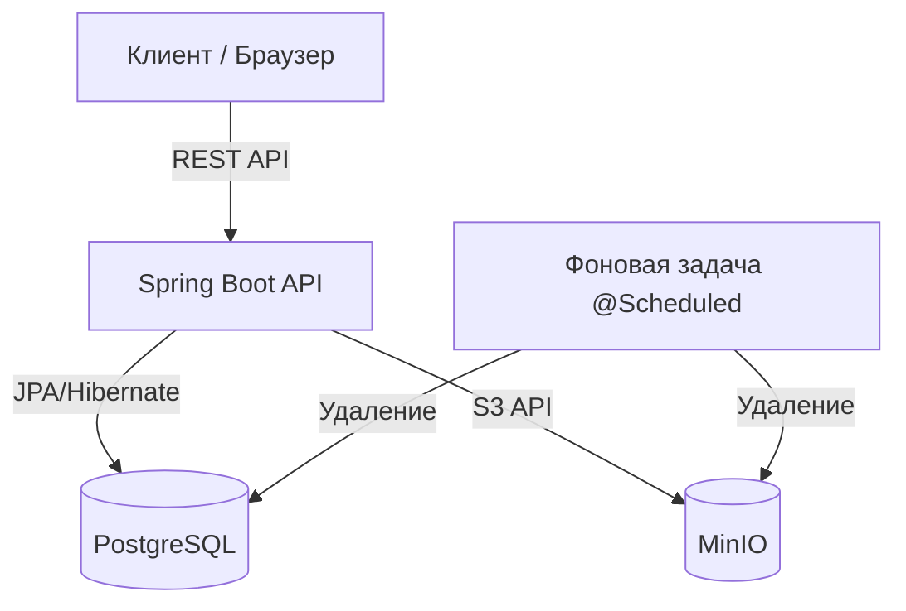

# Temfex

[](https://www.oracle.com/java/)
[](https://spring.io/projects/spring-boot)
[](https://www.postgresql.org/)
[](https://min.io/)
[](https://github.com/Coosiks/Temfex/actions/workflows/ci.yml)

Сервис для безопасного и временного обмена файлами с ограниченным сроком жизни, лимитом скачиваний и защитой паролем (аналог WeTransfer).

## Особенности
- **Гибкие настройки ссылок**: срок жизни (TTL), лимит скачиваний, защита паролем.
- **Множественная загрузка**: автоматическая ZIP-архивация нескольких файлов «на лету» (в памяти) без сохранения промежуточных файлов на локальный диск сервера.
- **Rate Limiting**: защита API от спама и DDoS с помощью Bucket4j (раздельные корзины для загрузки и скачивания).
- **Предпросмотр**: встроенный просмотр изображений и PDF прямо в браузере (заголовок `Content-Disposition: inline`).
- **QR-коды**: мгновенная генерация QR-кода для удобной передачи ссылки на мобильные устройства.
- **Автоочистка**: фоновая задача (`@Scheduled`) автоматически удаляет просроченные файлы из БД PostgreSQL и объектного хранилища MinIO.
- **Статистика**: отслеживание количества скачиваний и лог последних запросов.
- **Документация**: интерактивная OpenAPI/Swagger документация.

## Стек технологий
- **Backend**: Java 25, Spring Boot 3.4, Spring Security, Spring Data JPA
- **Database**: PostgreSQL 16, Flyway (миграции)
- **Storage**: MinIO (S3-совместимое API)
- **Rate Limiting**: Bucket4j
- **QA & Testing**: Postman Collection (API Tests), Manual Test Cases (Docs), JUnit 5
- **Documentation**: Springdoc OpenAPI (Swagger UI)
- **DevOps**: Docker, Docker Compose, GitHub Actions

## Архитектура



## Быстрый старт

### Требования
- Java 25
- Docker & Docker Compose

### Запуск
1. Клонируйте репозиторий:
   ```bash
   git clone https://github.com/Coosiks/Temfex.git
   cd Temfex
   ```
2. Запустите инфраструктуру (PostgreSQL + MinIO):
   ```bash
   docker compose up -d
   ```
3. Запустите приложение:
   ```bash
   ./mvnw spring-boot:run
   ```
4. Откройте в браузере:
   - Приложение: `http://localhost:8080`
   - Swagger UI: `http://localhost:8080/swagger-ui.html`

## Тестирование и контроль качества (QA)

Проект сопровождается набором артефактов для функционального, регрессионного и API-тестирования:

1. **Коллекция Postman для автоматизированного тестирования API:**
   - Путь: [`postman/Temfex.postman_collection.json`](postman/Temfex.postman_collection.json)
   - Включает 12 запросов с `pm.test`-ассертами на статусы ответов (200, 403, 404, 415), валидацию JSON-схем, сохранение переменных окружения (`fileId`, `shortId`, `protectedShortId`), проверку парольной защиты, исчерпания лимита скачиваний, отдачи QR-кода и inline-предпросмотра.
   - Запуск возможен как в Postman, так и в CI через `newman run postman/Temfex.postman_collection.json`.

2. **Ручные тест-кейсы (Manual Test Cases):**
   - Путь: [`docs/manual-test-cases.md`](docs/manual-test-cases.md)
   - Документировано 8 подробных сценариев в формате *Цель / Предусловия / Шаги / Ожидаемый результат*:
     - **TC-01**: Загрузка одиночного файла и скачивание по ссылке
     - **TC-02**: Множественная загрузка и ZIP-сжатие «на лету»
     - **TC-03**: Парольная защита ссылок (валидный / невалидный пароль)
     - **TC-04**: Исчерпание лимита скачиваний (`maxDownloads`)
     - **TC-05**: Истечение TTL и фоновая очистка MinIO + PostgreSQL шедулером
     - **TC-06**: Ограничение частоты запросов через Bucket4j (HTTP 429)
     - **TC-07**: Предпросмотр PDF и изображений в браузере
     - **TC-08**: Генерация и сканирование QR-кодов

## API Документация

Полная документация всех эндпоинтов доступна через Swagger UI: `http://localhost:8080/swagger-ui.html`

## Автор

- GitHub: [@Coosiks](https://github.com/Coosiks)
